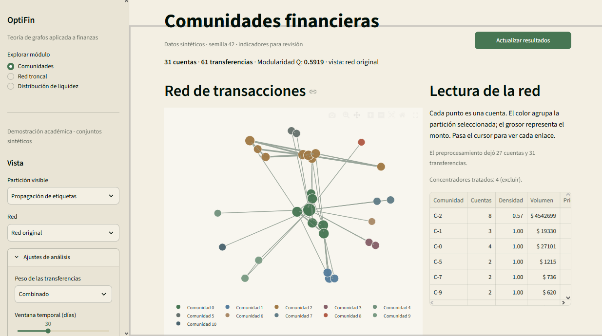

<div align="center">

# OptiFin – Sistema de Análisis y Optimización de Redes Financieras

**Universidad Nacional de San Antonio Abad del Cusco (UNSAAC)**  
*Facultad de Ingeniería Eléctrica, Electrónica, Informática y Mecánica*  
*Escuela Profesional de Ingeniería Informática y de Sistemas*  

**Asignatura:** Programación III (2026-II)  
**Proyecto:** Sistema de Análisis y Optimización de Redes Financieras


</div>

---

## Autores

| Estudiante | Código |
|---|---|
| Amilcar Estacio Medrano | `200822` |
| Kevin Heli Choquecahua Gutierrez | `245570` |
| Jeliel Enrique Aramburu | `210927` |
| Michael Augusto Baez Monge | `225418` |

---

## Vista Previa de la Interfaz

<div align="center">
  
</div>

---

## Descripción

**OptiFin** modela redes financieras mediante grafos e implementa tres escenarios críticos del sector bancario utilizando **algoritmos de teoría de grafos y optimización implementados íntegramente desde cero** en Python 3:

| Módulo | Escenario Operativo | Algoritmo Principal | Alternativas Comparadas |
|---|---|---|---|
| **Módulo 1** | Gestión, validación y modelamiento de redes | Lista de adyacencia (`Graph`, `Node`, `Edge`) | — |
| **Módulo 2** | Detección de comunidades (fraude y lavado de activos) | **Louvain** con ejecución multi-semilla | Umbral (BFS + Union-Find), Propagación de Etiquetas (LPA) |
| **Módulo 3** | Diseño de red troncal de menor costo | **Kruskal + Union-Find** | Prim con min-heap binario |
| **Módulo 4** | Distribución de liquidez y cuellos de botella | **Dinic** + Corte Mínimo | Edmonds-Karp, Ford-Fulkerson (DFS) |
| **Módulo 5** | Evaluación empírica, benchmarks y validación | `perf_counter` + `tracemalloc` + pendiente log-log | Oráculos cruzados con NetworkX |

---

## Instalación

```bash
pip install -r requirements.txt
```

**Dependencias principales:** `matplotlib`, `networkx` (exclusivamente para layouts visuales y oráculos independientes en pruebas), `pytest`, `pytest-cov`, `streamlit`, `plotly`, `pandas`.

> **Nota metodológica:** `networkx` **no** se utiliza para resolver ningún problema algorítmico. Todos los algoritmos (BFS, DFS, Union-Find, Tarjan low-link, Louvain, LPA, Kruskal, Prim, Dinic, Edmonds-Karp y Ford-Fulkerson) están implementados desde cero en `src/algoritmos/`.

---

## Uso Rápido

```bash
# 1. Generar datos sintéticos reproducibles (semilla fija)
python scripts/generar_datos.py

# 2. Ejecutar demostración completa de todos los módulos (no interactiva)
python main.py --demo

# 3. Ejecutar menú interactivo en terminal
python main.py

# 4. Lanzar interfaz gráfica web local (Streamlit + Plotly)
streamlit run app.py

# 5. Ejecutar módulos individuales con datos personalizados
python main.py --modulo 2
python main.py --modulo 3 --datos data/red_troncal.json
python main.py --modulo 4 --datos data/distribucion_liquidez.json

# 6. Ejecutar benchmarks de rendimiento y escalabilidad
python main.py --benchmark

# 7. Generar gráficas de complejidad algorítmica en reports/
python scripts/graficar_complejidad.py

# 8. Ejecutar suite completa de pruebas automatizadas
pytest -v
```

---

## Resultados Destacados (`seed=42`)

| Escenario | Métrica | Resultado Obtenido |
|---|---|---|
| **Módulo 2 – Comunidades** | Modularidad Louvain ($Q$) | `0.5919` |
| **Módulo 2 – Comunidades** | Estabilidad multi-semilla | `100.0%` |
| **Módulo 3 – Red Troncal** | Ahorro frente a red completa | `\$108,437.71` (`59.2%`) |
| **Módulo 4 – Liquidez** | Flujo máximo distribuido | `\$1,825,000.00` |
| **Módulo 4 – Liquidez** | Teorema Max-Flow / Min-Cut | Verificado (`Flujo == Corte`) |
| **Módulo 5 – Pruebas** | Suite automatizada (`pytest`) | **33/33 PASAN** |

---

## Estructura del Repositorio

```text
proyecto_optifin/
├── main.py                             # CLI interactiva y no interactiva
├── app.py                              # Interfaz web interactiva (Streamlit)
├── requirements.txt                    # Dependencias del proyecto
├── data/                               # Datasets sintéticos y vista previa
│   ├── transacciones.json              # Red transaccional (Módulo 2)
│   ├── red_troncal.json                # Red de infraestructura (Módulo 3)
│   ├── distribucion_liquidez.json      # Red de efectivo (Módulo 4)
│   ├── Preview.png                     # Captura de la interfaz gráfica
│   └── README_datos.md                 # Documentación de formatos y campos
├── scripts/
│   ├── generar_datos.py                # Generador reproducible de datos
│   └── graficar_complejidad.py         # Generador de gráficas de complejidad
├── src/
│   ├── graph.py                        # Estructura común (Graph, Node, Edge)
│   ├── gestion_red.py                  # Carga CSV/JSON y validación estricta/tolerante
│   ├── analisis_transacciones.py       # Orquestador del Módulo 2
│   ├── enrutamiento_financiero.py      # Orquestador del Módulo 3
│   ├── distribucion_liquidez.py        # Orquestador del Módulo 4
│   ├── evaluacion_resultados.py        # Benchmarks y casos adversarios (Módulo 5)
│   ├── visualizacion.py                # Gráficos estáticos (Matplotlib)
│   ├── dashboard_visualization.py      # Gráficos interactivos (Plotly)
│   ├── utils.py                        # Utilidades transversales
│   └── algoritmos/                     # Algoritmos puros e independientes
│       ├── union_find.py               # Union-Find O(α(N))
│       ├── recorridos.py               # BFS, DFS, puentes y articulaciones
│       ├── comunidades.py              # Louvain, LPA, Umbral, Modularidad
│       ├── arbol_expansion.py          # Kruskal y Prim
│       └── flujo.py                    # Dinic, Edmonds-Karp, Ford-Fulkerson
├── tests/                              # 33 pruebas unitarias y oráculos NetworkX
├── reports/                            # Reportes Markdown y gráficas PNG generadas
└── docs/
    ├── decisiones.md                   # Decisiones de diseño y supuestos
    ├── justificacion_algoritmos.md     # Análisis técnico y complejidad
    └── informe.md                      # Informe técnico final
```

---

## Garantías de Correctitud y Gráficas de Complejidad

Todos los algoritmos propios son validados frente a oráculos independientes de **NetworkX**:

- `networkx.minimum_spanning_tree` → Kruskal y Prim (tolerancia relativa $10^{-5}$)
- `networkx.maximum_flow` y `networkx.minimum_cut` → Dinic, Edmonds-Karp y Ford-Fulkerson
- `networkx.algorithms.community.modularity` → `calcular_modularidad`

Al ejecutar `python scripts/graficar_complejidad.py`, se generan en `reports/` las curvas teóricas, benchmarks empíricos con pendiente log-log ($\alpha$) y perfiles de memoria pico (`complejidad_teorica.png`, `benchmark_mst.png`, `benchmark_flujo.png`, `benchmark_comunidades.png`, `resumen_complejidades.png`).
